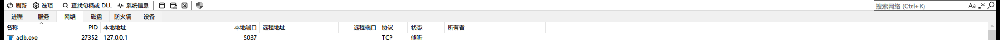

# SystemInformer-Zh

**System Informer 简体中文显示层。** 不改 `SystemInformer.exe` 一个字节，双击照常启动，界面变中文。




---

## 这是什么

一个**运行时文本替换层**。它在 System Informer 进程里接管所有「把文字画到界面上」的出口，查一份词典把英文换成中文，并把结果画回原处。

因为改的是「画字这一步」而不是程序本身，所以：

| | |
|---|---|
| **不动原程序** | `SystemInformer.exe`、`.sys`、各插件 DLL 全部保持原版，文件校验与数字签名都不受影响 |
| **双击照常** | 用 IFEO 把启动转交给一个启动器，快捷方式、开始菜单、任务栏固定都不用改 |
| **升级简单** | 换新版本只要新 exe 与旧版没有结构性差异，词典与钩子都不用重编 |
| **随时可退** | 一条命令撤销，程序立刻回到原生启动方式 |

当前词典 **1217 条**，覆盖主窗口、右键菜单、选项页、各属性页、插件菜单与列表列头。

---

## 它怎么做到的

### 先看清 System Informer 是怎么画字的

它的界面文字有四个来源，各自需要不同的拦截点：

| 来源 | 例子 | 拦截点 |
|---|---|---|
| 控件文本 | 对话框、按钮、选项页条目、树与列表项 | `SendMessageW(WM_SETTEXT / CB_ADDSTRING / TVM_INSERTITEMW …)` |
| 列表与表头 | 各页的列标题（`SysHeader32`） | `SendMessageW(HDM_INSERTITEMW / LVM_INSERTCOLUMNW …)` |
| 工具栏与菜单栏 | ToolStatus 插件自绘的工具栏 | `SendMessageW(TB_ADDBUTTONS / TB_SETBUTTONINFO)` |
| 自绘文本 | 上面这些控件真正落笔时 | `DrawTextW / DrawTextExW / TextOutW / ExtTextOutW`（及 A 版） |

前三类是「写入型」消息：字符串就在消息参数里，改参数即可；第四类是「绘制型」调用：文字已在内存里，只能改写指针或就地覆盖缓冲区。

### 为什么不能在程序目录放一个同名 DLL

两条路都被堵死了，这是实测出来的：

1. System Informer 在启动约 **0.17 秒**时开启 `ProcessSignaturePolicy = MicrosoftSignedOnly`。此后任何未签名 DLL 的加载都以 **577（0x241）** 硬失败。
2. 它**不把程序目录纳入 DLL 搜索路径**，所以同目录放一个 `uxtheme.dll` 之类也不会被优先加载。

唯一能抢在策略生效之前的动作，是**在目标进程还挂起时注入**。这就是启动器存在的理由。

### 启动器为什么这么写

启动器（`si_zh_launcher.exe`）做的是：

```
CreateProcessW(target,
    DEBUG_ONLY_THIS_PROCESS | CREATE_SUSPENDED)   ← 两个旗标缺一不可
  -> DebugActiveProcessStop()                     ← 先分离，否则注入会卡死
  -> InjectDll(zh_hook.dll)                       ← 此刻主线程还没进加载器，锁是空的
  -> Ready / Go / Done 握手，等钩子真正启用
  -> ResumeThread()                               ← 到这里目标才第一次执行自己的代码
```

两个旗标各自解决一个具体问题，都不是「顺手加的」：

- **`DEBUG_ONLY_THIS_PROCESS`** —— IFEO 的 Debugger 语义是「把靶子替换成调试器」。调试器再 `CreateProcessW` 靶子时 IFEO 会再次套用，于是无限自我复制、靶子永远起不来。只有带这个旗标的创建方式会跳过 IFEO 的二次替换。
- **`CREATE_SUSPENDED`** —— 只给 `DEBUG` 而不给它会踩一个很隐蔽的坑：主线程已跑进加载器、停在初始断点上，**加载器锁被持有**，此时远程 `LoadLibraryW` 会被永久挡住（现象是日志停在调试事件之后、钩子 DLL 的 `DllMain` 从未执行）。

而「先分离调试器、再注入」是另一个实测结论：只要进程还处在「调试态且调试事件未被消费」的状态，内核就压着它，远程 `LoadLibraryW` 永远不返回；分离后同一个调用 **4 毫秒**就返回了。分离**不会**放行 `CREATE_SUSPENDED` 的主线程，所以「先分离、再注入、最后放行」既解掉卡死又保住了时序。

配套的钩子侧要点（都写在 `src/hook/zh_hook.cpp` 的注释里）：

- `commctrl.h` 里的 `CM_TB_ADDBUTTONS` 之类是**历史遗留名**，默认解析到 ANSI 数值。真实 Unicode 消息是 `0x0403 / 0x0432 / 0x0434` —— 用错常量会让整类消息落进 `default` 被丢弃，症状是「表头能汉化、工具栏完全无效」。
- `DrawTextW` / `TextOutW` 内部都会再调 `ExtTextOutW`。不加闸同一串会被处理两次，日志里出现重复记录，排障时会让人误判载体。
- System Informer 的列表（`PhTreeNew`）是**自绘**的：在自己的 `WM_PAINT` 里建内存 DC、画完再 `BitBlt`。`WindowFromDC()` 对内存 DC 返回 `NULL`，所以必须钩 `BeginPaint` / `EndPaint` 自己维护「当前正在绘制的窗口」。
- 每个 `PhTreeNew` 下挂着**两个** `SysHeader32`，先建的是列数为 0 的空壳。取「第一个匹配到的」会永远拿到空壳。

---

## 目录结构

```
SystemInformer-Zh/
├── assets/
│   └── systemInformer-zh.ico      启动器图标（内嵌进 EXE）
├── dict/                          词典与流水线输入（进版本库）
│   ├── zh_dict.txt                最终词典（生成物，随仓库提供以便直接用）
│   ├── zh_dict.base.txt           人工基线（第 1 段，勿动）
│   ├── passolo.txt                Passolo 导出的英中对照（第 2 段来源）
│   ├── ui_gap.tsv                 从源码抽出的 UI 串清单
│   └── rc_literals.json           从 .rc 抽出的资源串
├── docs/                          README 用的截图
├── scripts/
│   ├── build.ps1                  构建全套产物到 dist\
│   ├── install.ps1                铺文件 + 写 IFEO
│   ├── uninstall.ps1              撤销（先摘 IFEO，再谈清理）
│   └── verify-ifeo.ps1            IFEO 端到端验收
├── src/
│   ├── hook/zh_hook.cpp           显示层钩子（编译为 zh_hook.dll）
│   ├── launcher/
│   │   ├── si_zh_launcher.c       启动器
│   │   ├── si_zh_launcher.rc      图标 + 版本信息
│   │   └── resource.h
│   └── third_party/minhook/       MinHook（BSD-2，随仓库自带，保证可独立构建）
└── tools/                         词典流水线与验证脚本（Python）
    ├── paths.py                   所有路径的唯一出处
    ├── build_zh_dict.py           合并各段 -> 扁平表
    ├── organize.py                扁平表 -> 分类词典
    ├── ui_zh.py                   译文表（第 4 段，手工维护）
    ├── merge_missed.py            合并运行期收集到的未命中串
    └── verify_*.py / *_probe.py   验证与诊断
```

`build/`、`dist/`、`si-src/`、`test-app/` 都是产物或外部依赖，不进版本库。

---

## 快速开始

### 1. 构建

需要 **Visual Studio 的「使用 C++ 的桌面开发」工作负载**（脚本用 `vswhere` 自动找 `vcvars64.bat`）。不需要 CMake，不需要 vcpkg —— MinHook 已随仓库自带。

```powershell
pwsh -File scripts\build.ps1
```

产物在 `dist\`：

| 文件 | 说明 |
|---|---|
| `si_zh_launcher.exe` | 启动器，带 `systemInformer-zh.ico` 图标 |
| `zh_hook.dll` | 显示层钩子，由启动器注入 |
| `zh_dict.txt` | 词典 |

脚本结束时会自检图标是否真的内嵌进 EXE、以及启动器是否仍是 GUI 子系统（否则双击会闪黑框）。

### 2. 安装

```powershell
# 管理员 PowerShell
pwsh -File scripts\install.ps1
```

自动定位 System Informer 安装目录（优先正在运行的实例），把三个产物铺到 `<安装目录>\_zhcn\`，然后写 IFEO。也可以用 `-AppDir` 显式指定。

想先不动注册表、只铺文件：加 `-NoIfeo`，然后直接双击 `_zhcn\si_zh_launcher.exe`。

装完双击原来的图标即可。**如果 System Informer 当时正在运行，需要重启它** —— 词典是启动时一次性读入的，正在跑的进程不会变中文。

### 3. 卸载

```powershell
# 管理员 PowerShell
pwsh -File scripts\uninstall.ps1              # 只摘 IFEO，程序文件保留
pwsh -File scripts\uninstall.ps1 -RemoveFiles # 连 _zhcn 目录一起删
```

> ⚠️ **不要手工删除 `_zhcn` 目录**。IFEO 的 Debugger 指向 `_zhcn\si_zh_launcher.exe`，指向的文件不存在时 System Informer **会直接启动失败**（报「系统找不到指定的文件」），不会回退到原生方式。要删就先跑 `uninstall.ps1` —— 它的第一步永远是摘掉 Debugger 值。

---

## 词典

### 格式

UTF-8、无 BOM、LF 换行。每行 `原文<TAB>译文`，`#` 开头是注释。**译文为空的行会被加载器跳过**，所以自动收集来的「待翻译」条目可以安全地留在文件里。

词典在启动时一次性读入，改词不必重编译 DLL —— 改完重启程序即可看到效果。

### 分类

`dict\zh_dict.txt` 按资源类型分区，每区前面有来源说明：

| 区 | 内容 | 条数 |
|---|---|---|
| `[01]` | 对话框 `DIALOG` | 387 |
| `[02]` | 版本信息 `VERSIONINFO` | 6 |
| `[03]` | 菜单 `MENU` | 201 |
| `[04]` | 工具栏与按钮 | 17 |
| `[05]` | 列表与树 · 列头 | 124 |
| `[06]` | 选项页 | 56 |
| `[07]` | 属性页字段 | 37 |
| `[08]` | 插件 | 155 |
| `[09]` | 提示与消息 | 0 |
| `[10]` | 其他代码内字符串 | 182 |
| `[11]` | 外部数据与系统名称 | 52 |
| `[12]` | 运行时未命中（待翻译） | 0 |
| `[13]` | 数据行内容（勿译，取证用） | 0 |
| | **合计** | **1217** |

关于 `[09]`：**System Informer 根本没有 `STRINGTABLE` / `MESSAGE TABLE` / `MENU` 资源**。把 34 个 `.rc` 全扫一遍，只有 `DIALOG` 274 块、`VERSIONINFO` 18 块、`ACCELERATORS` 3 块 —— 它的菜单是 `menubar.c` 用代码搭的，字符串是 C 字面量。所以这两个区在 SI 上不存在对应资源，`[09] = 0` 是事实而非遗漏。

### 运行期收集未命中的串

钩子会把「界面上出现过、但词典里没有」的串收集到与词典同目录的 **`zh_dict.missed.txt`**，由 `merge_missed.py` 显式合并。

为什么不直接写进 `zh_dict.txt`：那个文件是启动时被读的词典，运行期往里追加，进程一旦被强杀就会留下半行，下次加载直接读到脏数据；而且它是生成物，重跑构建就被覆盖。

为什么不只在退出时写：`TerminateProcess`（任务管理器结束进程）**不走 `DLL_PROCESS_DETACH`**，只在退出时写会把这些场景的数据全丢掉。所以有三个触发点：

| 触发点 | 覆盖的场景 |
|---|---|
| 首次见到某个新串就立即追加一行 | 强杀也不丢 |
| 周期检查点（默认 15 秒，`ZHHK_MISSFLUSH` 可调） | 强杀 + 崩溃 |
| 退出钩子（`NtTerminateProcess` / `RtlExitUserProcess`） | 正常退出，全量刷新 |

**收集什么**是这套机制里最花功夫的部分。界面上大多数「新串」其实是**数据** —— 进程名、服务名、设备名、内存占用、PID。直接把它们收进来会把待翻译区淹没。

判据分三层，全部基于「这个串画在哪儿」而不是「它长什么样」：

1. **控件指纹**：收集时一并记下控件链、列表列头签名、文本落在第几列。进程 / 服务 / 设备 / 防火墙列表的控件类**全是 `PhTreeNew`、控件 ID 全是 0、父链也一样** —— 唯一能区分的就是列头。于是「它画在服务列表的名称列」成为硬证据，比按名字猜可靠得多（`Auto start (trigger)` 是界面枚举值，`AppvStrm` 是本机服务名，词形上无法区分）。
2. **本机数据比对**：查注册表服务名与 `DisplayName`（含 `@acpi.inf,%X%;…` 间接引用和 `@dll,-id` 资源引用）、驱动名、进程名。
3. **数值形态**：纯数字、小数、`DOMAIN\user`、文件名样式。

还有一类**必须按模式丢弃**：运行期**拼接**出来的串。例如进程列表的 tooltip 是 `L"Console application: %s (%lu)"`、`L"Signer: %s"` 等片段拼成的整句，收集器只看得见拼完的结果（里面夹着 PID 和进程名），每次运行都不一样，词典的精确匹配永远命中不了。同理还有 `L"Copy \"%s\""`（列名运行时给出）和 `L"Ser&vice (%s)"`（ExtendedServices 插件）。

### 词典流水线

```
dict\passolo.txt          683 行 Passolo 导出（第 2 段）
dict\zh_dict.base.txt     122 条人工基线（第 1 段）
tools\ui_zh.py            556 条手工译文（第 4 段）
dict\ui_gap.tsv           源码 UI 串清单（第 4 段的键来自这里）
        │
        ├─[tools\build_zh_dict.py]──> build\zh_dict.merged.txt      扁平表
        │
        └─[tools\organize.py]────────> build\zh_dict.categorized.txt 分区表（给人看）
                                       build\zh_dict.index.tsv       逐条出处（审计）
                                       dict\zh_dict.txt              部署用（最终）
```

重新生成词典需要 **System Informer 源码树**（要从里面抽 `.rc` 资源串和代码字面量）。用环境变量指过去：

```powershell
$env:SI_SRC = 'D:\src\systeminformer-master'
python tools\build_zh_dict.py
python tools\organize.py
```

日常维护的顺序是：

1. 正常用一段时间，让钩子把没翻到的串收集起来；
2. `python tools\merge_missed.py` —— 出报告、出翻译工作表、并进词典；
3. 把决定要译的条目补进 `tools\ui_zh.py`（这样才能长期保下来，直接改 `zh_dict.txt` 下次重建会被覆盖）；
4. 重跑流水线。

---

## 已知限制

| 限制 | 原因 |
|---|---|
| 状态栏的 `CPU usage: 1.82%` 之类不译 | 源码里是 `L"CPU usage: %s"` 拼好再交给 `SB_SETTEXT`。词典是精确匹配，拿不到拼完的串。要解决得在钩子里加**前缀匹配** |
| 进程 tooltip 的整段说明不译 | 同上，由十余个片段拼成 |
| 标题栏上的按钮（如 `Options`）不译 | 非客户区由 DWM 绘制，字符串钩子够不着 |
| 只覆盖 x64 | 目前只构建 `zh_hook.dll` 的 64 位版本；32 位的 System Informer 不适用 |
| 词典是精确匹配 | 同一个英文词在不同控件里意思不同时（如 `Free` 在内存列表里是「可用」、在右键菜单里是「释放」），只能取一个。彻底解决需要给词典加**作用域** |
| `SecurityLayer` 类防病毒软件可能对 IFEO 报警 | IFEO 也是恶意软件常用的持久化位置，这是该方法固有的代价 |

---

## 环境与兼容性

开发与验证环境：

- Windows 11 x64
- Visual Studio（MSVC v14x 工具链）
- System Informer **4.0.26255.346**（`SystemInformer.exe` SHA256 `C982C2F5…`）
- 启动器与钩子均为 `/MT` 静态链接，不依赖 VC 运行时

因为整个方案建立在「拦截 `SendMessage` 与 GDI 文本输出」之上，它**不依赖 System Informer 的内部结构**。只要新版本仍然用 comctl32 的公共控件和标准 GDI 画字（这一点多年来没变），换版本不需要改代码。

---

## 常见问题

**装完界面还是英文？**
先重启 System Informer —— 词典只在启动时读一次。仍不行就用 `_zhcn\si_zh_launcher.exe --check` 看它到底解析到了哪些路径。

**双击没反应 / 报「系统找不到指定的文件」？**
`_zhcn` 里的文件被删了或被杀软隔离了。跑 `scripts\uninstall.ps1` 先把 IFEO 摘掉，程序立刻能正常启动，然后重新 `install.ps1`。

**想让某个词换个译法？**
改 `dict\zh_dict.txt` 里对应行（用 UTF-8 无 BOM 保存），重启程序即可。想长期保留就同时改 `tools\ui_zh.py`。

**我怎么知道钩子有没有生效？**
`si_zh_launcher.exe --log <目标>` 会写出启动器日志和钩子日志，里面有载入条目数与 HIT / miss 计数。

---

## 许可与致谢

- [MinHook](https://github.com/TsudaKageyu/minhook) —— 导出层 API 挂钩，BSD 2-Clause，已随仓库自带（`src/third_party/minhook`，含原始许可）。
- [System Informer](https://systeminformer.sourceforge.io/) —— 本项目的汉化对象，MIT。本项目不修改也不分发它的任何二进制文件。
- 部分译文参考了 Passolo 导出的英中对照与 Windows 中文版自身的术语习惯。

本项目自身以 MIT 许可发布，详见 `LICENSE`。
